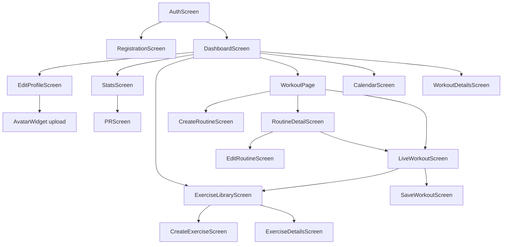
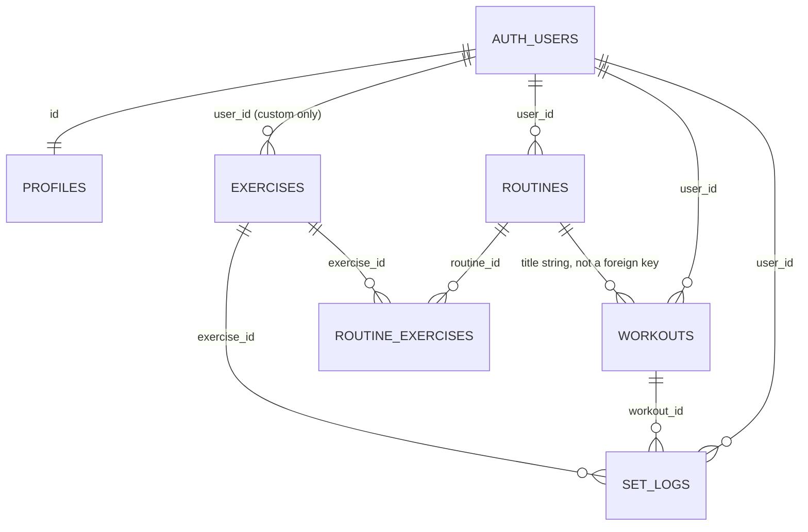

# IronLog Legacy Architecture Blueprint

Source: `ironlog-legacy/` (read-only analysis). Nothing in that folder was modified.

The app’s Dart package is `akhyar_fitness`. The Material app title is **Apex Log**. Registration copy calls the product **IronLog**. There is no committed database migration: `exercise.sql` is empty and `README.md` is the default Flutter stub. Every table, column, and type below is **inferred from client queries and inserts**. A column the UI never touches may still exist in Supabase. Where the client disagrees with itself, both behaviors are recorded.

---

## 1. Tech Stack Summary

| Layer | What the legacy app actually uses |
| --- | --- |
| UI framework | Flutter (Dart SDK `^3.9.2`), Material 3 dark theme, imperative `Navigator` + `MaterialPageRoute`. Targets Android, iOS, web, macOS, Windows, and Linux from the stock Flutter scaffold. |
| App state | `provider` `ChangeNotifier`, but only for the live-workout stopwatch (`WorkoutProvider`). Every screen keeps its own `StatefulWidget` state and calls Supabase directly. |
| Backend | Supabase: Postgres, Auth (email/password), and Storage. Client package `supabase_flutter` `^2.0.2`. |
| Local database | None. No SQLite, Hive, Isar, or `shared_preferences`. The app does not work offline. |
| Charts | `fl_chart` `^0.66.0` (bar, line, radar). |
| Calendar | `table_calendar` `^3.1.0`. |
| Media | `image_picker` `^1.0.7` for the avatar. Uploads go to the public Storage bucket `avatars`. |
| Other UI libs | `intl` for dates, `confetti` for in-session PR celebration. `flutter_svg` and `path` are in `pubspec.yaml` and are never imported. |

`WorkoutProvider` owns a `Stopwatch` plus a 1-second `Timer`. It exposes `currentDuration` (`HH:MM:SS`), `isWorkoutActive`, and `startTime`. `startWorkout()` is idempotent while the stopwatch is running. `stopWorkout()` stops and resets the stopwatch and the display string, but it does **not** clear `startTime`.

There is no repository, service layer, or dependency injection. Screens call `Supabase.instance.client` inline. The Supabase URL and anon key are hardcoded in `lib/main.dart`.

---

## 2. Core Features & User Flows

### 2.1 Navigation that is actually reachable

`AuthGate` listens to `auth.onAuthStateChange`. A session opens `DashboardScreen`. No session opens `AuthScreen`.



Three screens are **not linked** from this graph:

- `HistoryScreen` (`history_screen.dart`) — never imported.
- `ProfileScreen` (`profile_screen.dart`) — never imported. Its “7 Day Streak” and “Elite” status are string literals.
- `workout_hub_screen.dart` — a second class also named `DashboardScreen`. Importing it next to the real dashboard would not compile. Its Workout tile navigates to `DashboardScreen()`, which would open itself.

### 2.2 Authentication and registration

**Login (`AuthScreen`)**

- Fields: email, password, show/hide password.
- Empty email or password shows “Please fill in all fields”. No format or strength checks.
- Login calls `auth.signInWithPassword`. `AuthException.message` is shown; any other error is “An unexpected error occurred.”
- “Forgot Password?” requires a non-empty email, then `auth.resetPasswordForEmail`, and always shows “Reset link sent!” with no failure path.
- “Create one” pushes `RegistrationScreen`. The signup branch inside `_handleAuth` is dead: the button never calls it.

**Registration (`RegistrationScreen`) — three pages, swipe disabled**

1. Account: email, password, username.
2. Profile: full name, gender chip (`Male` or `Female`, default `Male`), birth date (`1950` … today, picker opens on year 2000).
3. Body: height cm, weight kg, optional body-fat %, target weight kg.

Finish calls `auth.signUp`, then `profiles.insert` with `id = user.id` plus the fields above. There is no per-step validation, so empty strings and unparsed numbers (`null` doubles) can be written. On success it `pop`s back to the auth screen. It does not navigate to the dashboard. If email confirmation is required, the user still has to log in. The comment in the method says a trigger already creates the profile row and the client should update it; the code inserts. A trigger plus this insert will collide on `profiles.id`.

**Session end**

Dashboard logout calls `auth.signOut`, then `pushAndRemoveUntil` a brand-new `MyApp` (a second `MaterialApp` inside the first). `ProfileScreen` would instead replace the stack with `AuthScreen` and skip `AuthGate`. Neither path is a single source of truth for “logged out.”

### 2.3 Dashboard

Loaded in `initState` and on pull-to-refresh.

- Header: avatar, full name, bio, “N SETS THIS WEEK”.
- Metric strip: BMI, FFMI, bench/bodyweight strength, goal weight. Each opens an info dialog. FFMI’s dialog can open the Navy body-fat calculator.
- A thin progress bar is `current_weight / target_weight`, clamped to 0…1.
- Weekly bar chart of volume (kg) or set count, range “30 Days” or “3 Months”.
- Four tiles: Statistics, Exercises, Start Workout, Calendar.
- Training history: newest workouts, three visible until “SEE ALL”. Each card shows routine name, notes, duration in minutes, volume in kg, set count, and up to three exercises as `Nx Name`. Tap opens `WorkoutDetailsScreen`. The overflow menu edits the log or deletes it.

**Edit a past workout**

- Change the calendar date (2022 … today) and start/end clock times.
- If the new end is before the new start, one day is added to the end.
- Writes `start_time`, `end_time`, and `duration_seconds`. Volume and sets are left untouched.
- Delete removes the `workouts` row only. Child `set_logs` are not deleted in the client, so this only works if the database cascades.

### 2.4 Profile edit and avatar

`EditProfileScreen` loads `profiles` for the current user.

- Required: username (stored lowercased). Empty username is rejected.
- Optional writes: full name, bio, gender (`Male` / `Female` / `Other`), birth date as an ISO string, height, current weight, target weight, body fat, avatar URL.
- Save is `profiles.upsert` on `id`. Postgres unique violation `23505` is shown as “Username already taken!”

`AvatarWidget` picks a gallery image at 80% quality, uploads `{userId}.{extension}` to the `avatars` bucket with `upsert: true`, stores the public URL on `profiles.avatar_url`, and calls back into the form. The dashboard reads that URL. `ProfileScreen` ignores it and draws a generic person icon.

### 2.5 Exercise library

`ExerciseLibraryScreen` loads exercises where `is_custom = false` **or** `user_id` is the current user, then sorts by name.

Sections:

- **Recent** — any loaded exercise whose id appears in the latest 50 `set_logs` rows. That query is not filtered by `user_id`.
- **Your Exercises** — custom exercises that are not in Recent. Edit and delete are shown only here.
- **All Exercises** — global exercises that are not in Recent.

Selection mode (used while building a routine or a live workout) pops the chosen `Exercise`. Browse mode opens `ExerciseDetailsScreen`.

**Create / edit exercise**

- Name required.
- Primary muscle: Chest, Back, Shoulders, Legs, Arms, Core, Cardio.
- Equipment: Dumbbell, Barbell, Machine, Cable, Bodyweight, Kettlebell.
- Strength category: `bench`, `squat`, `deadlift`, `overhead_press`, `row`, `pull`, `push`, `other`.
- Tracking type: `reps_and_weight` (“Weight & Reps”), `bodyweight_reps`, `duration`.
- Insert sets `user_id` and `is_custom: true`. Update forces `is_custom: true` and does not check ownership in the client.
- Delete is a hard `exercises.delete` by id after a confirm dialog.

**Exercise details**

Shows primary muscle, a line chart of every historical set’s weight in time order, and three records: heaviest weight, best estimated 1RM (Brzycki), best single-session volume. “SUMMARY” is a label, not a tab. History is not filtered by `user_id` in this query.

### 2.6 Routines

**List (`WorkoutPage`)**

- “Start an Empty Workout” opens the live logger with title `"Empty Workout"` and no exercises.
- Routines for `user_id` are loaded with nested `routine_exercises → exercises`.
- A card shows the title and a comma-joined exercise list. Tap opens the detail screen. The play icon does not start the workout. `_startRoutine` exists and is unused.
- FAB opens create. Pull-to-refresh reloads.

**Create**

- Title and at least one exercise are required.
- Exercises are added from the library (duplicates allowed) and reordered.
- Inserts `routines` (`title`, `user_id`), then `routine_exercises` (`routine_id`, `exercise_id`, `order_index` from 0). No description is written here.

**Detail**

- Line chart: last 10 `workouts.total_volume` values whose `routine_name` equals the routine title, oldest first, labeled S1, S2, … The query does not filter `user_id` and does not use a routine id.
- Lists each exercise’s name, primary muscle, and equipment.
- Edit opens `EditRoutineScreen`. After a successful edit the detail screen pops with `true` so the list refreshes.
- “START WORKOUT” opens the live logger with the routine title and its exercises.

**Edit**

- Title required, description optional, at least one exercise.
- Update header, delete all `routine_exercises` for that routine, insert the new ordered list.
- Delete confirms, deletes the `routines` row, then pops twice. Child rows are not deleted in the client.

### 2.7 Live workout logging

`LiveWorkoutScreen` starts `WorkoutProvider` after the first frame.

On open, for each exercise already in the routine, sequentially:

1. Load the latest `set_logs` row for that `exercise_id` (ordered by `created_at`, not scoped to the user).
2. Load every set in that `workout_id` for that exercise, ordered by `set_index`.
3. Load the user’s heaviest historical `weight` for that exercise (`user_id` + `exercise_id`).
4. Set rest to 180 seconds.
5. Prefill one row per previous set (weight and reps as text). If there is no history, prefill one empty set.

**Per exercise the user can:**

- Read the name.
- Type exercise notes. These are copied into the in-memory payload and then dropped on save. `set_logs` has no notes column, and the workout row only stores the summary note.
- Tap the rest label and pick a new duration with `CupertinoTimerPicker` (minutes and seconds). The choice lives only in memory, per exercise id, for this session.
- See set rows: index, previous `weight x reps` or an em dash, weight field, reps field, check button.
- Check a set. Inputs lock. Rest starts. Live volume and set count recompute.
- Uncheck a set. Rest stops. Stats recompute.
- Swipe a row left to delete it.
- Add a set, copying the previous row’s weight and reps text.
- Open the menu to replace the exercise (library, selection mode) or remove it.
- Add an exercise from the library. Duplicates by id are ignored.

Replace and mid-workout add call `_initExerciseData` only. They do not fetch previous sets or the all-time max, so those exercises start with one blank set and a PR baseline of “unknown” (treated as 0 only if a fetch had run).

**Rest timer**

- Starts at the exercise’s configured seconds (default 180) when a set is checked.
- Ticks once per second. Hitting 0 cancels the timer, fires `HapticFeedback.heavyImpact`, and hides the bar.
- Overlay: progress = remaining / duration-at-start, −15s, +15s (clamped 0…999), skip.
- Only one timer exists. Checking another set replaces it.

**Finish rules**

- Zero completed sets: snackbar “Complete at least one set before finishing!” and no navigation.
- Otherwise the provider is stopped, duration is `now - startTime` (the original start, even if the display was reset), and `SaveWorkoutScreen` receives the title, duration, volume, completed-set count, and completed logs.
- Each completed log is `{ exercise_id, weight, reps, set_index }`. `set_index` is the current row position + 1, so deleting a middle row renumbers later rows. Weight/reps that do not parse become 0. Exercise notes are not included in the insert.

**Discard**

Back and the chevron both ask “Discard Workout?”. Confirm stops the provider and pops. Nothing is written.

### 2.8 Save workout

Summary shows title, duration (`Nh Mm` or `Nmin`), volume in kg, set count, today’s date (display only; the user cannot move it), and a notes field (“How did it feel? Any PRs?”).

Finish, if a user is signed in:

1. Insert `workouts` with `user_id`, `routine_name`, `total_volume`, `total_sets`, `notes`, `duration_seconds`, `start_time = now - duration`, `end_time = now`, `status = 'completed'`.
2. Insert all set logs with `workout_id`, `user_id`, `exercise_id`, `weight`, `reps`, `set_index`.
3. `popUntil` the first route and show “Workout Saved!”.

The two inserts are not a transaction. If step 2 fails, the workout row remains with no sets. Closing the summary returns to the live screen. The stopwatch is already reset, but `startTime` is still the original timestamp, so a second finish recomputes duration from that original start.

### 2.9 Workout detail

Opened from a dashboard history card. Shows user, timestamp, routine name, minutes (`duration_seconds ~/ 60`), volume, set count, and “Records”.

`records_broken` is read from the workout. The client never writes it. The fallback is the literal **6**, so a normal saved workout displays 6 records.

The muscle-split bar is hardcoded: Shoulders 33%, Legs 17%, Back 17%, Chest 17%, Arms 16%. It does not read `primary_muscle`. `photo_url` is read and never shown.

Sets are grouped by exercise name. For each set, score = `weight * reps`. “PR” and “TOP SET” are computed only inside this workout, and both flags use that same score, so the highest-scoring set in the card always wears both badges. This is not an all-time PR.

### 2.10 Statistics

**Last 7 days**

- Day chips for today and the six days before it. Default selection is today.
- “TOTAL SETS” for the selected day is the count of `set_logs` rows on workouts that started that calendar day, not the `total_sets` column.
- Muscle chips (Chest, Back, Shoulders, Arms, Legs) light up when any set that day has a `primary_muscle` string that contains the chip name, case-insensitive. Core and Cardio have no chip.

**Distribution block**

- Range dropdown: 30 days or 3 months (default 3 months).
- Radar chart of set counts for Chest, Back, Shoulders, Arms, Legs. A set counts only when `primary_muscle` equals one of those five strings exactly. Core, Cardio, and any other spelling add nothing.
- Footer totals over the same window: workout count, duration hours (sum of `end_time - start_time` in minutes, divided by 60, one decimal), volume (`Nk` when ≥ 1000), and summed `total_sets`.

The trophy opens `PRScreen`.

### 2.11 Personal records

All of the user’s `set_logs` are loaded with the joined exercise name and primary muscle, heaviest weight first.

Per exercise **name** (not id): keep the heaviest weight. If two rows share that weight, keep the one with more reps.

Collapsed row: MAX WEIGHT, REPS, EST. 1RM (Epley). Expanded row replaces the stats with a line chart of every set’s weight over `created_at` for that exercise id. Dates are formatted and then unused; the chart has no axis titles.

### 2.12 Calendar

All `workouts.start_time` values for the user become day markers (green dot). The calendar is month-only, from 1 Jan 2020 through today. Selecting a day updates selection state and does not list that day’s workouts.

- **Week streak:** consecutive Monday–Sunday weeks, walking backward from the current week, that contain at least one workout. If the current week is empty, the streak is 0.
- **Rest days:** whole days from the latest workout day to today. Today’s workout yields 0. No history also yields 0, so “never trained” and “trained today” look the same.

---

## 3. Data Models & Schema

Supabase Auth owns `auth.users`. The app’s profile row uses the same UUID. There is no custom users table.



The last line is a logical link only. `workouts.routine_name` stores the title text captured when the session started (`"Empty Workout"` or the routine title). Renaming a routine, or two routines sharing a title, changes which sessions the volume chart groups together.

### 3.1 `profiles`

One row per auth user. Client treats `id` as the primary key.

| Column | Inferred type | Written by | Notes |
| --- | --- | --- | --- |
| `id` | uuid, PK | registration, profile upsert | Same value as `auth.users.id`. |
| `email` | text | registration | Not updated later. |
| `username` | text, unique | registration, profile upsert | Upsert lowercases it. Unique violation code `23505`. |
| `full_name` | text | registration, profile upsert | |
| `gender` | text | registration, profile upsert | Registration: `Male` / `Female`. Edit: also `Other`. Dashboard default before load is `"male"`. |
| `birth_date` | date or timestamptz | registration, profile upsert | Registration sends a `DateTime`. Edit sends an ISO string. |
| `height` | float8, cm | registration, profile upsert | |
| `current_weight` | float8, kg | registration, profile upsert | |
| `target_weight` | float8, kg | registration, profile upsert | |
| `current_body_fat` | float8, percent | registration, profile upsert, Navy calculator | Calculator writes one decimal, clamped to 3.0–50.0. |
| `bio` | text | profile upsert | |
| `avatar_url` | text | avatar upload, profile upsert | Public Storage URL. |

### 3.2 `exercises`

Global library rows (`is_custom = false`, `user_id` null) plus user-created rows.

| Column | Inferred type | Notes |
| --- | --- | --- |
| `id` | uuid, PK | Read by the client. Never sent on insert (database default). |
| `name` | text | Required in the form. Model fallback `"Unnamed Exercise"`. |
| `equipment` | text | Model fallback `"None"`. |
| `primary_muscle` | text | Model fallback `"Other"`. Create screen uses the seven muscle names in §2.5. |
| `exercise_type` | text | `reps_and_weight` (default), `bodyweight_reps`, `duration`. The logger ignores this and always stores weight and reps. |
| `image_url` | text, null | Mapped on the `Exercise` model. No screen writes it. |
| `is_custom` | bool | `false` for the shared library. Create/update of a user exercise sets `true`. |
| `user_id` | uuid, null | Set on custom insert. Library filter: `is_custom = false OR user_id = me`. |
| `category` | text | **This is the column the create/edit screen and the bench query use.** Values: `bench`, `squat`, `deadlift`, `overhead_press`, `row`, `pull`, `push`, `other`. |
| `strength_category` | text, null | Mapped by `Exercise.fromJson` / `toJson`. The create screen never writes it, and `toJson()` is never called. Editing an exercise therefore reloads the dropdown from a column that stays empty, and the form falls back to `other`. |

### 3.3 `routines`

| Column | Inferred type | Notes |
| --- | --- | --- |
| `id` | uuid, PK | Returned from insert. |
| `user_id` | uuid, FK → auth user | |
| `title` | text | Required. |
| `description` | text, null | Written only by the edit screen. |

### 3.4 `routine_exercises`

| Column | Inferred type | Notes |
| --- | --- | --- |
| `routine_id` | uuid, FK → `routines.id` | |
| `exercise_id` | uuid, FK → `exercises.id` | |
| `order_index` | int | 0-based position at save time. The list query never `order`s by it, so display order is whatever Postgres returns. |

The client never reads a primary key for this table. Edit replaces the whole child set (delete by `routine_id`, then insert).

### 3.5 `workouts`

| Column | Inferred type | Notes |
| --- | --- | --- |
| `id` | uuid, PK | |
| `user_id` | uuid | |
| `routine_name` | text | Copied title. Model fallback `"Custom Workout"`. Not a foreign key. |
| `start_time` | timestamptz | On save: `now - duration`. Editable later from the dashboard. |
| `end_time` | timestamptz, null | On save: `now`. |
| `duration_seconds` | int | `duration.inSeconds` at save. Recomputed when the log is edited. History UI prefers this, then falls back to `end - start`. |
| `total_volume` | float8, kg | Sum of completed `weight * reps` at finish time. Not recomputed if the log is later edited. |
| `total_sets` | int | Count of completed sets at finish time. |
| `notes` | text | Summary note only. |
| `status` | text | Always inserted as `'completed'`. Never read. No in-progress row is written; a discarded session leaves no record. |
| `photo_url` | text, null | Read by workout details, never written, never displayed. |
| `records_broken` | int, null | Read by workout details with a fallback of 6. Never written. |

### 3.6 `set_logs`

| Column | Inferred type | Notes |
| --- | --- | --- |
| `id` | uuid, assumed | Never selected. |
| `workout_id` | uuid, FK → `workouts.id` | |
| `user_id` | uuid | Copied again onto every set. |
| `exercise_id` | uuid, FK → `exercises.id` | |
| `weight` | float8, kg | |
| `reps` | int | |
| `set_index` | int | 1-based position among the exercise’s rows at save time, including only completed sets in the iteration but using the full list index. |
| `created_at` | timestamptz | Used to find “the previous session” and to order PR charts. Not set by the client (database default). |

The save screen’s comment states that `set_logs.notes` does not exist. Per-exercise notes from the logger are discarded.

Joins the client depends on:

- `set_logs → exercises (name, primary_muscle, category, id)`
- `set_logs → workouts (start_time)`
- `workouts → set_logs → exercises`

### 3.7 Storage

Bucket `avatars`. Object name `{userId}.{fileExtension}`. Upload uses `upsert: true`, so a new picture replaces the old object only when the extension stays the same. The public URL is copied onto `profiles.avatar_url`.

### 3.8 In-memory models

`Exercise` maps the exercise columns above. `strengthCategory` reads `strength_category`, which is the wrong column relative to the form.

`WorkoutHistory` / `SetEntry` are used only by the unlinked `HistoryScreen`. `SetEntry` expects a nested `exercises.name`, plus `weight` and `reps`.

Live set state is not a model. It is `Map<exerciseId, List<{weight: TextEditingController, reps: TextEditingController, isDone: bool}>>`.

---

## 4. Business Logic & Calculations

Units are metric only: centimetres, kilograms, percent body fat. There is no unit preference.

### 4.1 Set volume and workout totals

A set counts only when the user has checked it.

```
setVolume   = weightKg * reps
workoutVolume = sum(setVolume) over checked sets in exercises still on the page
workoutSets   = count of those checked sets
```

Unparseable weight or reps contribute 0. Unchecked rows are ignored. Removing an exercise drops its sets from the totals immediately.

These two numbers are what get stored. Later screens trust `workouts.total_volume` and `workouts.total_sets` except the stats “sets today” card, which counts `set_logs` rows instead. Those two definitions diverge if a save is partial or if rows are removed in the database.

### 4.2 Duration

```
duration = finishInstant - provider.startTime
duration_seconds = duration.inSeconds
start_time = finishInstant - duration
end_time = finishInstant
```

The displayed clock is `HH:MM:SS` from a stopwatch ticked every second. The saved duration uses `DateTime` subtraction, not the formatted string.

Dashboard minutes: `duration_seconds ~/ 60`, or if that is 0 and `end_time` is present, `end - start` in minutes.

Stats duration: sum of `end_time - start_time` in minutes over the selected window, shown as hours with one decimal. Workouts with a null `end_time` add nothing. The stored `duration_seconds` column is not used here.

Edited logs recompute `duration_seconds` from the new start and end. If end is earlier on the clock than start, end moves forward one day.

### 4.3 Rest timer

- Default per exercise: 180 seconds.
- User override: any minute/second duration chosen in the session. Not stored.
- On check: remaining = that duration, max for the progress bar = that same duration.
- On each second: remaining decreases by 1.
- At 0: hide the bar and fire a heavy haptic.
- −15 / +15 adjust remaining only, clamped to 0…999. The progress denominator stays at the original duration, so +15 can push progress above 1.
- Uncheck or Skip hides the bar and cancels the timer.
- Checking a set does not wait for rest to finish, and the next check replaces the timer.

### 4.4 One-rep max — two formulas, two screens

**Epley, Personal Records screen.** Preserve this for the PR list.

```
if reps <= 1: estimated1RM = weight
else:         estimated1RM = weight * (1 + reps / 30)
```

Displayed as an integer kilogram value.

**Brzycki, Exercise Details screen.** Preserve this for the per-exercise “Best 1RM”, and guard it.

```
if reps > 0: estimated1RM = weight * (36 / (37 - reps))
best1RM = max(estimated1RM) over the user's sets for that exercise
```

The legacy code does not protect `reps >= 37`, which divides by zero or goes negative. The rebuild should keep Brzycki for this surface and define that guard explicitly (skip the set, or cap reps at 36).

The two screens will not show the same 1RM for the same set. That split is existing behavior. Pick one formula per surface and document it; do not silently merge them.

### 4.5 Personal records

**During a live set check**

```
isCelebration = enteredWeight > heaviest stored weight for this exercise
```

Reps are ignored. Bodyweight and duration types are treated as loaded weight. The in-memory record is never raised after a celebration, so every later set in the session that still beats the old database max celebrates again. Confetti plays and `HapticFeedback.vibrate()` fires. Nothing is written until the workout is saved. There is no `personal_records` table. PRs are always derived from `set_logs`.

**PR list**

Group by exercise name. Winner = maximum `weight`, then maximum `reps` on that weight. The chart under a row is every set’s raw weight in `created_at` order, not a personal-record series.

**Exercise details, besides Brzycki**

```
heaviestWeight = max(weight)
sessionVolume(workout) = sum(weight * reps) for that workout_id
bestSessionVolume = max(sessionVolume)
```

**Workout detail badges (do not preserve the bug)**

Inside that workout only, `score = weight * reps`. The set with the highest score is marked both PR and TOP SET. `records_broken` is not calculated. The rebuild should either compute real all-time records or drop the badge and the “Records” stat. Do not keep the fallback of 6.

### 4.6 Previous-session prefills

“Previous” means the `set_logs` row for that `exercise_id` with the latest `created_at`, then every set sharing that `workout_id` and `exercise_id`, ordered by `set_index`. Each of those sets becomes a prefilled, unchecked row. The “previous” column on row *i* shows that session’s set *i* as `weight x reps`. Extra new rows copy the last typed weight and reps.

The lookup is not filtered by `user_id`. With strict row-level security this is safe. Without it, one user can prefill another user’s sets.

### 4.7 Body metrics

Let `heightM = heightCm / 100`.

```
BMI = currentWeight / (heightM^2)     when heightM > 0 and weight > 0
```

| BMI | Label |
| --- | --- |
| &lt; 18.5 | UNDERWEIGHT |
| &lt; 25 | HEALTHY |
| &lt; 30 | OVERWEIGHT |
| otherwise | OBESE |

```
leanMass = currentWeight * (1 - bodyFatPercent / 100)
FFMI = leanMass / (heightM^2)          when height, weight, and body fat are all > 0
```

FFMI is hidden as `--` until body fat is present. These values are computed on the dashboard. They are not stored.

**US Navy body-fat estimate.** Inputs are tape measurements in centimetres. Height comes from the profile. Result is rounded to 1 decimal and clamped to \[3.0, 50.0\], then saved to `current_body_fat`.

```
log10(x) = ln(x) / ln(10)

male:
  495 / (1.0324 - 0.19077 * log10(waist - neck) + 0.15456 * log10(height)) - 450

female:
  495 / (1.29579 - 0.35004 * log10(waist + hip - neck) + 0.22100 * log10(height)) - 450
```

The male branch runs only when `profiles.gender == "male"` exactly. Registration and the editor store `"Male"`. After a normal signup the female formula runs, and hip defaults to 0. The rebuild should compare case-insensitively, require hip for female, and require `waist > neck` (and `waist + hip > neck`) before calling `log10`.

### 4.8 Relative strength and goal

Bench weight is the heaviest `set_logs.weight` whose joined `exercises.category` is `bench`, limited to the user’s **single most recent workout**, not an all-time max. If that workout has no bench set, the ratio is 0 and the UI shows `--`.

```
benchRatio = maxBench / currentWeight     when both are > 0
```

The info dialog describes tiers and does not compute them: 1.0× “Strong”, 1.5× “Advanced”, 2.0× “Elite”. The label under the number is always `BENCH/BW`.

```
kilogramsLeft = abs(targetWeight - currentWeight)
```

The “kg LEFT” color is orange when target is above current weight, green otherwise. The progress bar is `current / target` clamped to 0…1, which reads backwards for a cut (current already above target fills the bar).

### 4.9 Dashboard weekly chart

Window is 30 or 90 days of `workouts.start_time`, `total_volume`, and `total_sets`.

```
weekIndex = floor(daysBetween(workoutStart, now) / 7)
bucket[weekIndex] += volume or total_sets
```

Index 0 is the trailing 0–6 days, not a Monday-based week. A bucket whose sum is 0 is still drawn with height 10 so the bar is visible. That 10 is not real data. Tapping a bar sets the header to “Current Week” or “N Weeks Ago” from the bar’s index in the reversed list, which is not the same thing as the bar’s `x` week index.

“SETS THIS WEEK” sums `total_sets` for workouts in that same fetched window whose `start_time` is strictly after local Monday 00:00. It is not a calendar-week query of its own, and it does not count `set_logs`.

### 4.10 Stats muscle distribution

Over 30 or 90 days, count `set_logs` whose `primary_muscle` is exactly `Chest`, `Back`, `Shoulders`, `Arms`, or `Legs`. Each log adds 1 to that spoke. Volume is not used. The radar has no fixed maximum, so one large spoke flattens the others.

The 7-day muscle chips use a looser contains-match on the lowercased muscle name. A muscle can light a chip and still miss the radar.

### 4.11 Calendar streak

```
weekStreak = 0
weekStart = Monday 00:00 of the current week
while any workout day falls on Monday..Sunday of weekStart:
  weekStreak += 1
  weekStart -= 7 days

restDays = max(0, today - latest workout day) in whole days
```

An empty history sets both to 0.

### 4.12 Validation rules worth keeping

| Rule | Where |
| --- | --- |
| Login email and password must both be non-empty. | Auth |
| Registration currently has no field checks. The rebuild should require email, password, and username before the auth call, and reject non-numeric body inputs. | Registration |
| Username required on profile save; compare unique violations to “already taken”. | Edit profile |
| Custom exercise name required. | Create exercise |
| Routine title required and at least one exercise. | Create and edit routine |
| Finish is blocked until at least one set is checked. | Live workout |
| Body-fat result clamped to 3–50% and stored to 1 decimal. | Navy calculator |
| Edited workout end is rolled one day forward when it would otherwise precede start. | Dashboard |
| Password reset requires a non-empty email. | Auth |

---

## 5. Improvement Opportunities

These are defects and structural problems in the legacy code. The rebuild should keep the user-facing behavior in §§2–4 and drop the following.

### Security and data boundaries

- The Supabase URL and anon key are compiled into `lib/main.dart`. Move them to environment config and rotate the key that shipped in the legacy tree.
- Several reads omit `user_id`: previous-set lookup, exercise-detail history, the last 50 “recent” exercises, and routine volume history (matched on title only). Correctness currently depends entirely on row-level security that is not in the repo. Every query should be scoped to the signed-in user even when RLS exists.
- Custom-exercise update and delete send only the row id. Ownership has to be enforced in the database and in the client.
- Avatar uploads trust the file extension from the path and overwrite `{userId}.{ext}`. Restrict type and size, and use a stable object name so a `.jpg` then `.png` upload cannot leave two public files.
- `StatsScreen` builds a PostgREST `in` filter by joining ids into a string. Pass a real list parameter.
- Workout insert and set-log insert are not transactional. A failed second call leaves a workout with totals that do not match its sets. Write both in one database function.
- Deleting a workout or a routine does not delete children in the client. Declare `ON DELETE CASCADE` (or delete explicitly) and test it.
- Registration inserts `profiles` while the comment claims a trigger already did. Choose one path.

### Wrong or fake numbers

- Workout detail’s muscle split is a constant graphic. `records_broken ?? 6` invents six records. PR and TOP SET are the same intra-workout `weight * reps` max. `photo_url` is unused.
- `ProfileScreen` hardcodes a 7-day streak and “Elite”. It is also unreachable. Either wire a real profile or delete it.
- Dashboard chart draws 0 as 10. Week buckets are rolling 7-day windows while the copy says “Current Week”. Touch labels use list index after `reversed`, not the bar’s week index.
- “Sets this week” (sum of `total_sets` after Monday) and “sets today” (count of `set_logs`) are different metrics with the same word.
- Live PR detection is “weight greater than historical max weight”, ignores reps, and does not update within the session, so one heavy set retriggers confetti on every later check.
- Epley and Brzycki both ship, on different screens, with no shared helper. Brzycki is undefined at 37 reps.
- Navy male/female is a case-sensitive compare against `"male"`, but the forms save `"Male"`. The female formula then runs without hips.
- Goal progress uses `current / target`, which fills the bar for someone who has overshot a cut. The dialog’s 0.5–1% per week guidance is not enforced or even calculated.
- Bench ratio uses the latest workout only, and only rows with `exercises.category = 'bench'`. The model field `strength_category` is a different column, so the edit form reloads `'other'` and can wipe `category` on save.
- `exercise_type` (`bodyweight_reps`, `duration`) is stored and never honored. Every set is weight × reps. A timed or bodyweight exercise still asks for kilograms.
- Routine charts join on the title string. Rename, duplicate titles, and every “Empty Workout” collapse into one series. Store `routine_id` nullable on `workouts`.
- `routine_exercises.order_index` is written and then not used in the `select`, so order is not guaranteed.
- Calendar day selection does nothing. Rest days are 0 both for “trained today” and “never trained”.
- `HistoryScreen` and `workout_hub_screen.dart` are dead. The hub file declares a second `DashboardScreen`, and its Workout button constructs that same screen.

### Structure

- Screens are the data layer. `dashboard_screen.dart` is about 1,400 lines of fetch, BMI/FFMI/Navy math, chart bucketing, history rendering, and dialogs. The same glass-card helper is copy-pasted across most screens. Extract repositories and pure functions so volume, 1RM, body composition, streaks, and week buckets can be unit tested without a widget.
- `provider` is wired globally and then used as a stopwatch. Domain state (the draft workout) lives in a widget `Map` of `TextEditingController`s, so it dies on process kill and cannot be tested. A draft session model, including rest settings and notes, should outlive the widget.
- There is no offline queue, pagination, or cache. The dashboard and the PR screen download every workout or every set on each visit. Live start does one to three round-trips per exercise, in series.
- Navigation is ad hoc. Logout pushes a nested `MyApp`. Closing the save screen returns to a live workout whose clock was already stopped. Auth, discard, and save should have one coordinator.
- `Exercise.toJson` does not match the columns `CreateExerciseScreen` writes (`strength_category` vs `category`, no `user_id`). One mapping should own the row.
- Per-exercise notes are collected and thrown away. Either add a place to store them (workout note is a single field; set notes were explicitly rejected) or remove the input.
- The only test is the Flutter counter template. It constructs `const MyApp()`, but `MyApp` is not a const constructor and has no counter. It cannot pass.
- `WillPopScope`, `print` on the dashboard, and `withOpacity` are leftover APIs. `flutter_svg` and `path` are unused dependencies.
- Names drifted (`akhyar_fitness`, Apex Log, IronLog) and so did gender enums (`male` vs `Male`). Freeze one product name and one set of stored enums, and migrate existing rows.

### What to keep on purpose

Keep email/password auth, the three-step profile, routines with ordered exercises, empty workouts, set-by-set logging with previous-session targets, rest timers, checked-set volume, workout notes, the dashboard body metrics, both 1RM surfaces (with the Brzycki guard), derived PRs from set history, the 7-day and 30/90-day muscle stats, and the calendar streak rules. Fix the bugs above in the implementations. Do not copy the unreachable screens, the hardcoded records and muscle split, or the in-widget SQL.
